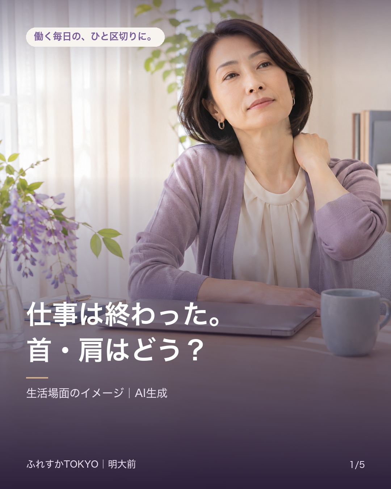
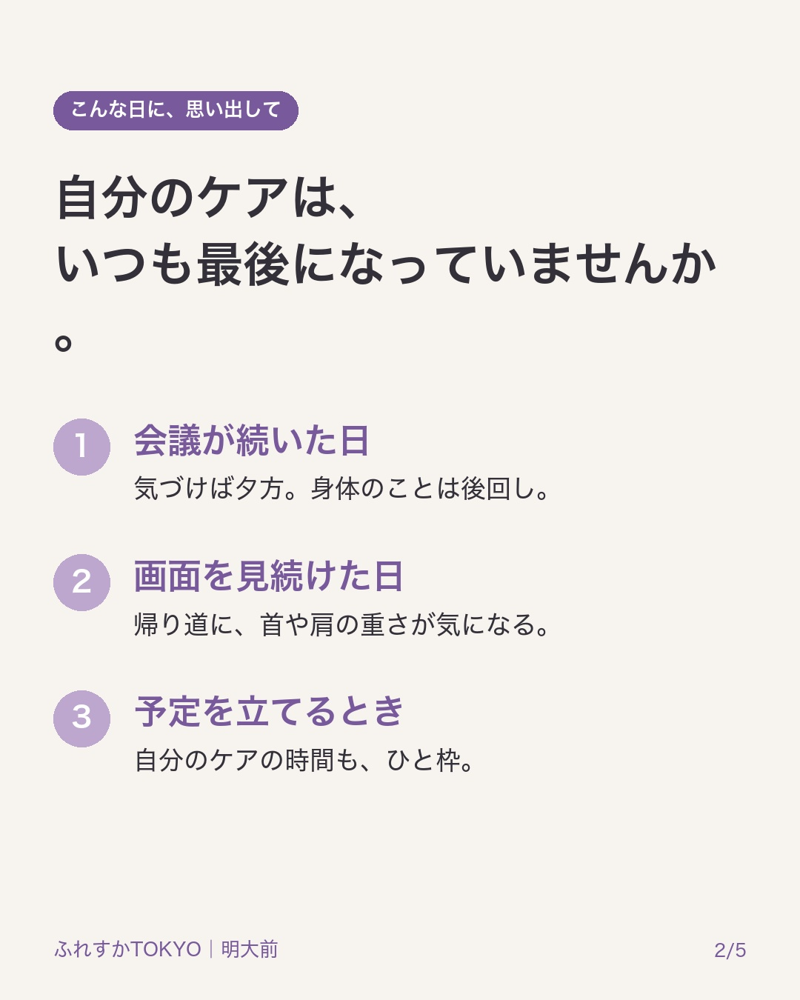
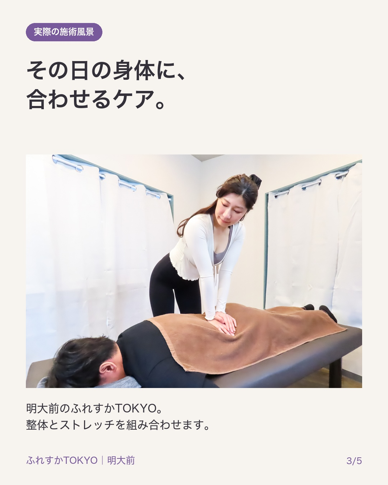
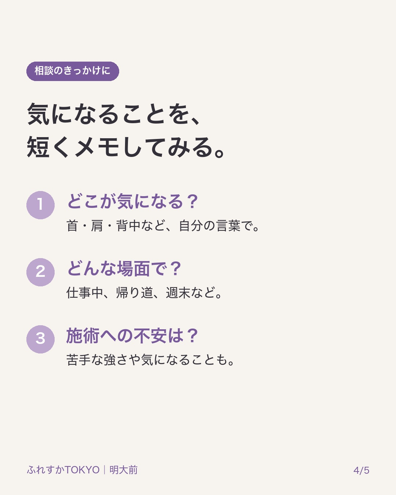
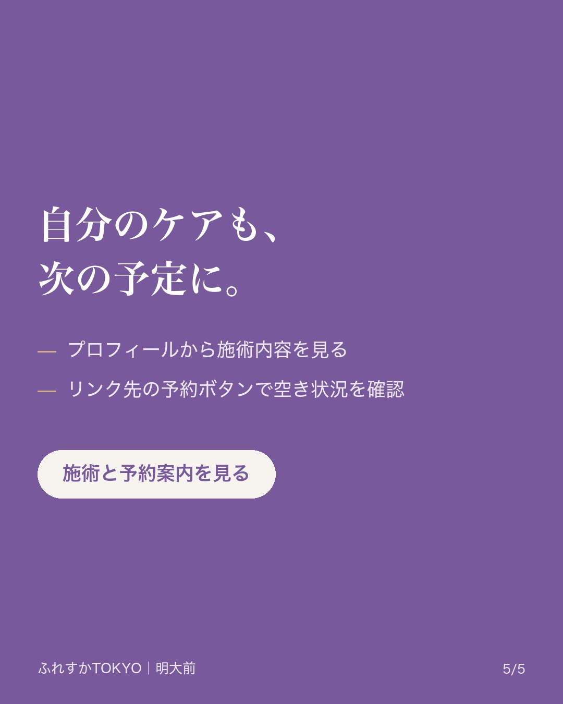

# 仕事は終わった。首・肩はどう？

仕事は終わった。首・肩はどう？

会議やパソコンで一日が過ぎ、自分のケアはまた今度。そんな日が続いていませんか。
気になる場所や、気になる場面を短くメモするところからでも。

ふれすかTOKYOは明大前のストレッチ整体。身体の状態に合わせて整体とストレッチを組み合わせます。

施術内容はプロフィールの店舗サイトへ。ご予約はサイト内の予約ボタンから、料金・条件・空き状況をご確認ください。

※表紙はAI生成の生活場面イメージです。施術写真は実際の店舗素材です。

#ふれすかTOKYO #明大前 #デスクワーク

