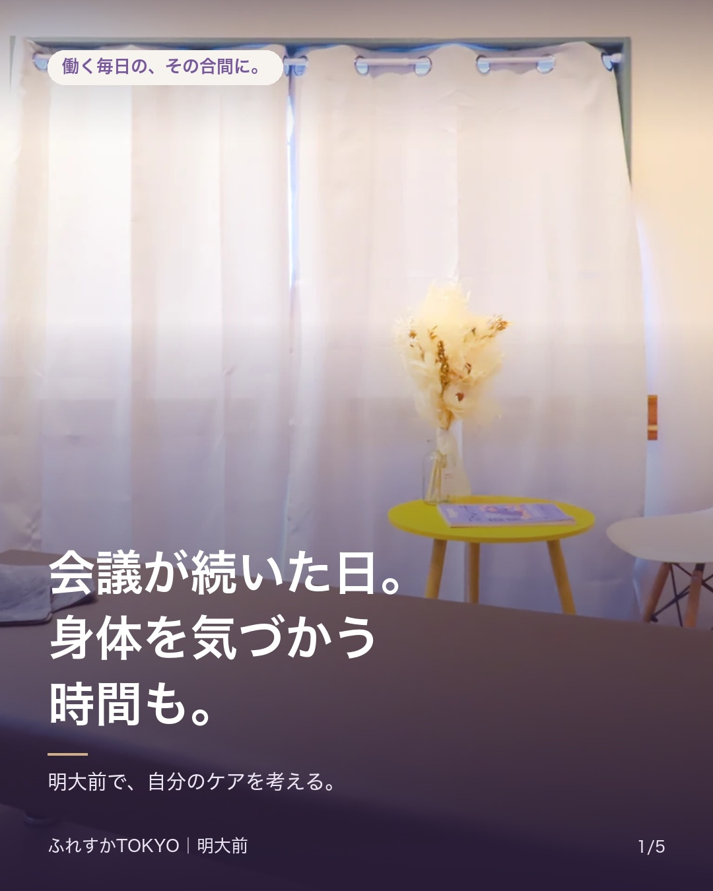
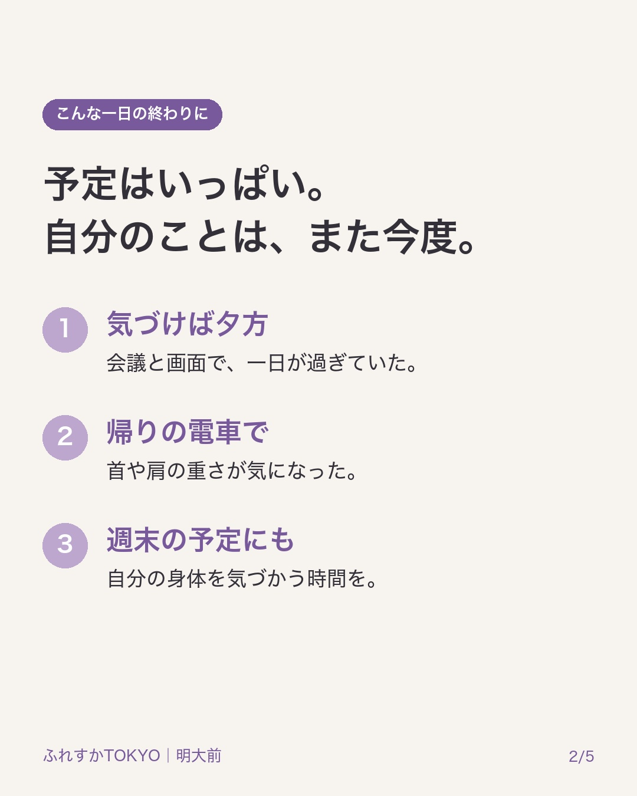
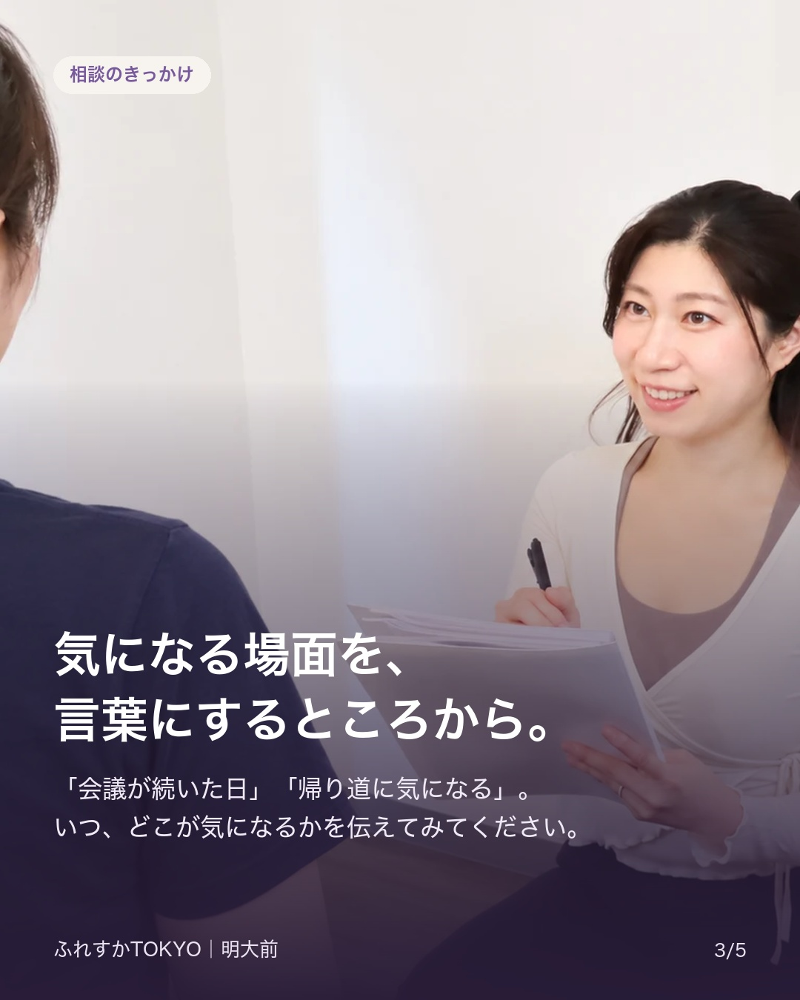
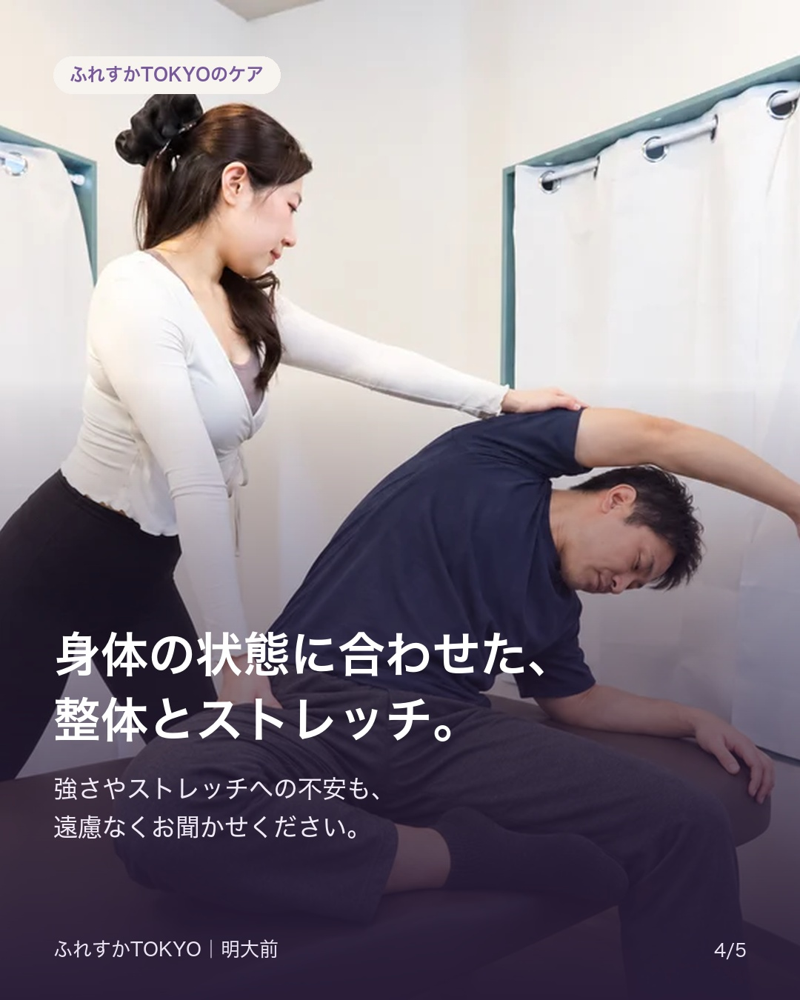
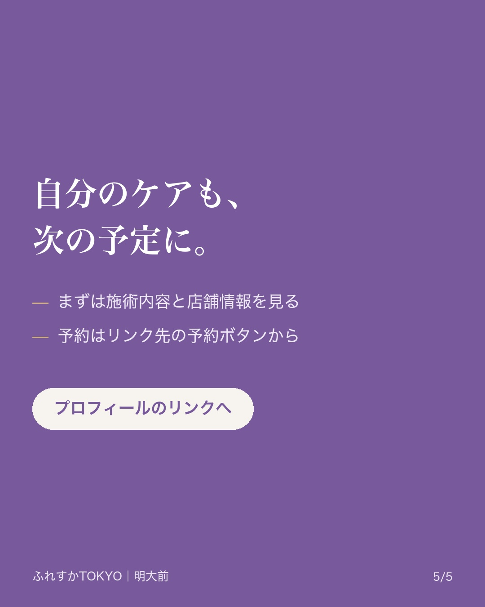

# 会議が続いた日。身体を気づかう時間も。

会議が続いた日。身体を気づかう時間も。

仕事の予定は埋まっているのに、自分のケアは「また今度」になっていませんか。
首や肩の重さが気になるなら、いつ・どこが気になるか、言葉にするところから。

明大前のふれすかTOKYOでは、身体の状態に合わせて整体とストレッチを組み合わせます。強さやストレッチへの不安もお聞かせください。

施術内容や店舗情報はプロフィールのリンク先へ。ご予約はサイト内の予約ボタンから、料金・条件・日時をご確認ください。

#ふれすかTOKYO #明大前 #デスクワーク

